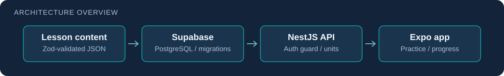

# Spanish for the Big Trip · typed lesson delivery

**Problem:** Hebrew-speaking travelers need short, practical Spanish practice, and lesson content must stay valid as the app and backend evolve.

**Implemented so far:** reviewed lesson content as JSON validated with a Zod contract, Supabase PostgreSQL with SQL migrations (courses, units, unit revisions, progress, an attempt log, account deletion), and a NestJS API with a token auth guard, a repository layer and a units endpoint, covered by unit and end-to-end tests. The Expo / React Native app is in progress.

**Status:** in development and not released. The first target is one complete unit; the full roadmap lives in the repository's planning files.

[Source](https://github.com/doric2000/spanish-for-the-big-trip) · [API](https://github.com/doric2000/spanish-for-the-big-trip/tree/main/api) · [Migrations](https://github.com/doric2000/spanish-for-the-big-trip/tree/main/supabase/migrations)

Inspect the API guard, repository and tests, and the SQL migrations for current behavior. No user, release or performance claim is made.
